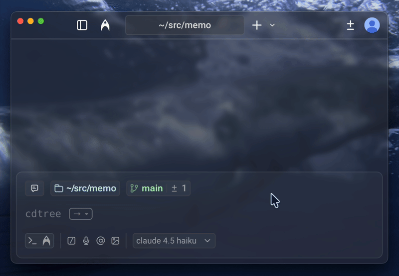

<p align="center">
  
</p>

<p align="center">
  <a href="https://github.com/shogoisaji/cdtree/actions">
    
  </a>
  <a href="LICENSE">
    
  </a>
</p>

# cdtree

A simple CLI tool to navigate directories with a tree view, similar to `tree` but interactive. It allows you to select a directory and change to it in your shell.

## Features

- Tree-like view starting at your home directory, auto-expanded to the current directory.
- Navigate using arrow keys (`Up`, `Down`, `Left`, `Right`).
- Press `f` to search directory names under the tree. The query has to appear as a continuous, case-insensitive run of characters (`abc` matches `XabcY`, not `ZBXC`). After typing pauses, matches appear as they are found, as an expanded tree with other entries hidden (Esc to exit). The rest of the tree keeps being searched in the background.
- Search continues while you navigate, in short time slices. `partial` means some directories remain unsearched because of scan limits or read errors; `No matches (partial search)` does not rule out matches in those directories.
- Enter to select a directory (files are ignored).
- Shell integration to change the parent directory.
- Broot-style automatic configuration.

<div align="center">
  
</div>

## Installation

### Homebrew (macOS)

```bash
brew tap shogoisaji/cdtree
brew install cdtree
```

### Cargo

Requires Rust and Cargo.

```bash
git clone https://github.com/shogoisaji/cdtree.git
cd cdtree
cargo install --path .
```

## Setup (Shell Integration)

1. Run the setup once:

```bash
cdtree --setup
```

2. Reload your shell config:

```bash
source ~/.zshrc
```

If you use Bash, source `~/.bashrc` instead.

The setup command writes a marked cdtree block to your shell rc file and only sources the launcher when it exists.

To inspect the current integration:

```bash
cdtree --doctor
```

To remove the shell integration:

```bash
cdtree --uninstall
```

## Usage

Simply run:

```bash
cdtree
```

- **Up/Down**: Move selection.
- **Right**: Expand directory.
- **Left**: Collapse directory or go to parent.
- **Enter**: Change to the selected directory (only when a directory is selected).
- **Space**: Toggle history mode. Select from recently visited directories.
- **f**: Fuzzy-search directory names under the tree root. After a short pause in typing, matches are listed as an expanded tree (ancestors included, everything else hidden) with the matched characters highlighted. Esc exits search.
- **v**: Toggle file visibility.
- **a**: Toggle hidden file visibility.
- **t**: (Tap) Change color theme randomly. (Double-tap) Reset theme.
- **q / Esc**: Quit.

## History Mode

Press **Space** to switch between tree view and history mode. In history mode, directories you've previously navigated to are listed in chronological order. Select an entry with **Up/Down** and press **Enter** to change to it.

History is automatically saved to `~/.config/cdtree/history.json` (up to 100 entries).

## Configuration

The color theme is saved automatically to `~/.config/cdtree/config.json`.

## License

[MIT](LICENSE)
